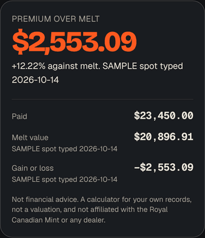
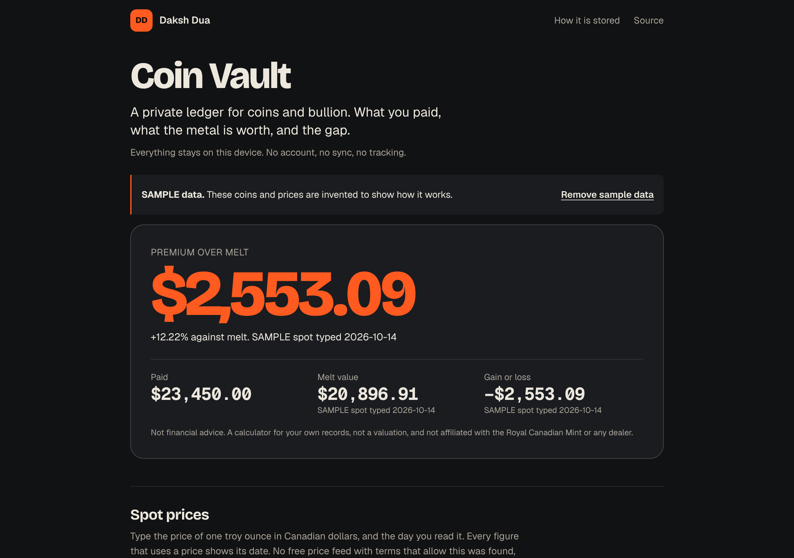

# Coin Vault

**A private ledger for coins and bullion: what you paid, what the metal is worth, and the gap. Nothing leaves your device.**

[**Try it live**](https://daksh2197.github.io/coin-vault/). Free, no account, works with no signal.

[](https://github.com/daksh2197/coin-vault/actions/workflows/ship.yml)
[](LICENSE)

<p align="center">
  
</p>

The demo above uses invented sample coins and invented prices.

## Why I built it

A coin has three prices: what was paid for it, what the metal is worth today, and what a collector would pay. I wanted the first two side by side, with the gap between them, on a phone, without telling any website what anyone owns.

The third price, the collector's, is not in here. This app does not compute it, and I did not want to pretend.

## What it does

- **Holds your coins and bars.** Name, metal (gold, silver, platinum, palladium), fineness, weight in grams or troy ounces, quantity, mint and year, what you paid and when, where it is kept, and a note for its story.
- **Three numbers per holding and in total.** Paid, melt value at the spot price you typed, and the premium you paid over melt as a percentage. Gain or loss against paid sits beside them.
- **Shows the date beside every price-based figure.** You type the spot price per metal. Each figure that uses it says which day you typed it, and the totals say so when the oldest price is more than seven days old.
- **Never invents a number.** No spot price for a metal means a dash instead of a zero. The totals say how many holdings were left out.
- **Splits your holdings by metal.** One bar and a table, by melt value.
- **Exports and imports a JSON file.** Optionally locked with a passphrase (AES-GCM, key from PBKDF2). A wrong passphrase gives one clear message. A forgotten passphrase cannot be recovered, and the page says so before you set one.
- **Prints an inventory sheet.** A white page, one row per holding, spot dates and the not-financial-advice line on it. Printing from anywhere in the app prints the sheet.
- **Works with no signal.** A service worker saves the app after the first visit.
- **Keeps your data on the device.** It lives in IndexedDB, the browser's built-in database. There is no server, no sync and no analytics. The only way data leaves is a file you save.



## The hard part in 30 seconds

```
fine ounces = weight of one piece x quantity x fineness
melt        = fine ounces x spot price (CAD per troy ounce)
premium     = (paid - melt) / melt
```

Weights are whole nanograms in a bigint. Money is integer cents. Each holding's melt is worked out exactly, then rounded once to the cent, halves up. A total is the sum of the rounded lines, so the page always adds up. One troy ounce is exactly 31.1034768 grams, which is 31,103,476,800 ng.

A worked case at an invented spot of $6,000.00 an ounce: one ounce at 0.9999 melts for $5,999.40. Pay $6,500.00 and the premium is 8.34% and the loss against paid is $500.60. That case is a test.

The database, the migrations, the file format and what local-first costs you are in [docs/THE-DATABASE.md](docs/THE-DATABASE.md).

## Run it yourself

You need [Node.js](https://nodejs.org) 22.12 or newer.

```bash
git clone https://github.com/daksh2197/coin-vault.git
cd coin-vault
npm ci
npm run dev     # the app, live-reloading, at http://localhost:5173
npm test        # every test, in a few seconds
npm run build   # the finished site, in dist/
```

## How it's built

| Piece | Job | Why this one |
| --- | --- | --- |
| TypeScript (strict) | The language | It catches a weight passed where a price goes before the app runs |
| Vite | Builds the site | One command, about 170 ms |
| Vitest and fake-indexeddb | Tests | The database tests run in Node against a stand-in for the browser's database |
| IndexedDB, used directly | The database | Under 200 lines of wrapper, comments included, beat a dependency for two tables |
| WebCrypto | Passphrase locking | Built into every browser, so there is no crypto library to trust |
| No framework | The screen | One page of forms and lists. The app's JavaScript is about 12 kB compressed |
| Service worker | Offline | Saves the app on the device the first time it opens |
| GitHub Actions and Pages | Test, then deploy | A failing test blocks the release. Hosting is free |

```
src/
  core/               the brain: no screen, no network
    decimal.ts        typed text to exact decimals; refuses "1,000" instead of guessing
    units.ts          weight to nanograms, fineness to parts per million
    money.ts          cents, quantities, and money text
    melt.ts           melt, premium, gain, totals, allocation. Start here.
    schema.ts         what a valid holding or spot price is
    form.ts           typed form text to a checked holding
    db.ts             IndexedDB and its migrations
    vaultfile.ts      export, import and merge of the backup file
    lock.ts           passphrase locking and unlocking
    dates.ts          real dates, today, ages
    types.ts          Holding, Spot, Metal
    sample.ts         the invented demo rows
    *.test.ts         the tests, next to the code they check
  ui/dom.ts           small helpers; text goes in with textContent only
  ui/words.ts         sentences that depend on numbers and dates
  main.ts             wires the form, the database and the screen
  styles/             the dakshdua.ca colours and the app's layout
public/sw.js          the offline worker
scripts/stamp-sw.mjs  stamps each build with a version
.github/workflows/ship.yml  test, then deploy
```

Want the guided tour? [docs/CTO-NOTES.md](docs/CTO-NOTES.md) explains the ideas in plain English, how to debug them, and five changes to try. The money side is in [docs/BUSINESS.md](docs/BUSINESS.md).

## What got caught along the way

- **A weight my own parser refused.** I first allowed six decimal places for every weight. A test that typed the troy ounce in grams, 31.1034768, failed because that has seven. Grams now take nine places (exact to the nanogram) and ounces six.
- **A Total row in invisible ink.** An independent review by a second Claude session that had not seen the build found that the printed inventory sheet showed its Total row in the dark theme's off-white on a white page. The tests could not see it, because it is a colour. It now has a print rule, and the browser check reads the computed colour in print mode.
- **Shares that added up to 99.99%.** The same review found that rounding each metal's share on its own could make three equal metals read 33.33% three times. The shares now use largest-remainder rounding and always add to 100.00%, with a test over 5,000 random mixes.
- **Two sevens.** One constant meant both "a spot price is getting old" and "Safari may clear a site left alone for a week". Changing one would have silently changed the other, so they are separate constants now.
- **A future date that said "today".** A price dated in the future showed "(today)". It now says "dated in the future".
- **A missing licence notice.** The three fonts need their licence text shipped with them. It is in `public/THIRD-PARTY-NOTICES.txt` now.

The review also re-derived the maths in Python with exact fractions and compared 6,000 random typed inputs: no mismatches.

## How this was built

I build with Claude as my pair programmer. I bring the problem and decide what the thing should do. Claude writes most of the code. I review it until I can explain every file, and [the CTO notes](docs/CTO-NOTES.md) are my study guide, in public. Every commit carries the co-author line.

## Data, sources and limits

- **Troy ounce.** 31.1034768 g exactly, as defined by the [LBMA](https://www.lbma.org.uk/wonders-of-gold/items/the-troy-ounce). Read October 13, 2026. It is a fact, and no licence is stated.
- **Fineness and size shortcuts.** The buttons for 0.9999, 0.99999 and 0.9995, and for sizes from 1/20 oz to 10 oz, are plain numbers I saw on [mint.ca](https://www.mint.ca) product pages on October 13, 2026. No Mint names, images, logos or mintage figures are used, and the Mint has granted no licence. Coin Vault is not affiliated with the Royal Canadian Mint or any dealer.
- **Prices.** There is no price feed. I looked for a free one with terms that allow use from a browser with no key, and did not find one I could confirm. You type the spot price, and the app shows its date.
- **Passphrase settings.** PBKDF2-HMAC-SHA256 with 600,000 rounds follows the [OWASP Password Storage Cheat Sheet](https://cheatsheetseries.owasp.org/cheatsheets/Password_Storage_Cheat_Sheet.html) (CC BY-SA 4.0), cited and not copied. Read October 13, 2026.
- **Safari's seven-day rule.** Described in [WebKit's tracking prevention post](https://webkit.org/blog/10218/full-third-party-cookie-blocking-and-more/). Read October 13, 2026.
- **Fonts.** Bricolage Grotesque, Geist and Geist Mono ship inside the app under the SIL Open Font License 1.1. The notices are in [public/THIRD-PARTY-NOTICES.txt](public/THIRD-PARTY-NOTICES.txt).
- **Sample data** is invented. Every sample row and price is labelled SAMPLE on screen.
- **Not financial advice.** Melt value is the metal content at a price you typed. It is not a valuation or an appraisal.

## What's next

- [ ] Photos of each holding, stored on the device and included in a backup only if you tick a box. Cut from this version because I could not test them properly in one pass.
- [ ] A free spot-price fetch, if I find a source whose terms allow it from a browser
- [ ] Several vaults

Ideas and pull requests are welcome.

## License

[MIT](LICENSE). Use it, fork it, keep your own coins in it.

Built in Calgary by [Daksh Dua](https://dakshdua.ca).
